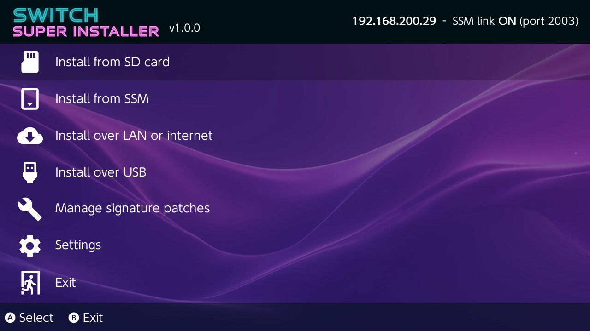
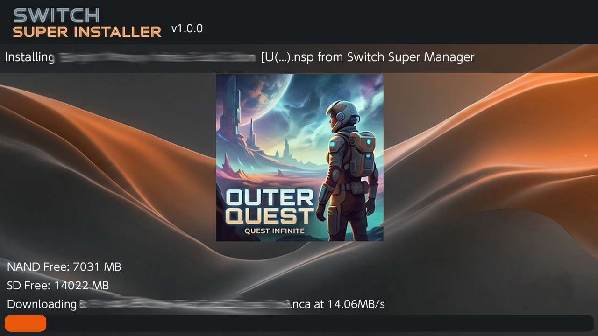
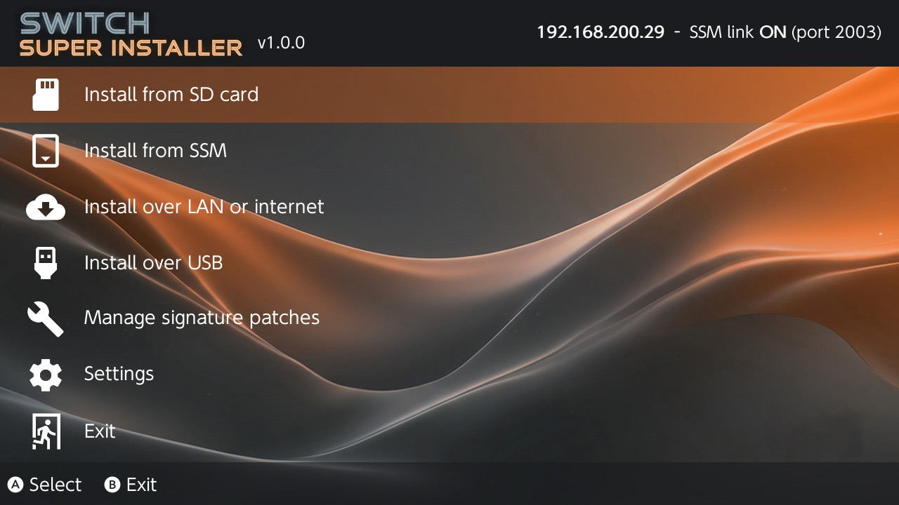
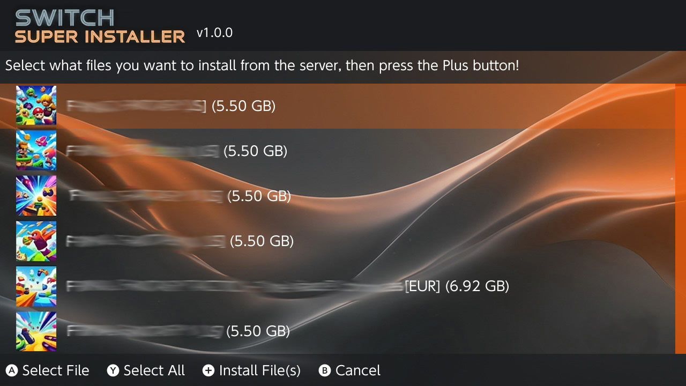

# Switch-Super-Installer

A homebrew installer for the Nintendo Switch, and the companion of **[Switch-Super-Manager](https://github.com/Ch1nguya/Switch-Super-Manager)**, a desktop manager for your game library.
Install NSP, NSZ, XCI and XCZ files from the SD card, over the network, from USB or straight from your Switch-Super-Manager library, and let it manage the console from the PC.

| | |
|---|---|
|  |  |
| *Main menu* | *Installing a file sent by Switch-Super-Manager* |

## Features
- Installs NSP / NSZ / XCI / XCZ files, including split files, from the SD card.
- Installs over your network or USB from tools such as [NS-USBloader](https://github.com/developersu/ns-usbloader), or from a web address or Google Drive.
- **Install from Switch-Super-Manager**: browse your SSM library from the console, with covers, sizes and regions, select several games and install them. The free SD and internal space are shown while installing.
- Checks the signature of the files before installing them.
- Installs and updates the signature patches (always the latest release).
- SSM sees what is installed on the console and its free space, and can refresh it whenever you want.
- Send cheats and covers from SSM to the console.
- Back up your saves and uninstall games from the PC.
- Optional **remote management**: SSM can install, uninstall and back up saves without any question on the console.
- Option to keep the console awake while it is charging.
- Choose the theme in the options, or make your own (see the [themes guide](https://github.com/Ch1nguya/Switch-Super-Manager/blob/main/docs/ssi-themes.md)).
- Available in English, French, German, Italian, Spanish, Portuguese, Japanese, Korean, Ukrainian and Chinese.

## What is new compared to TinWoo and Awoo

Switch-Super-Installer is built on TinWoo, itself based on Awoo Installer. On top of them:

**Added**
- Install from SSM (library list, covers, several games at once).
- Cover of the game, and free SD / internal space, on the install screen.
- Everything SSM needs: console inventory, cheats, covers, save backups, uninstalling, remote management.
- Option to keep the console awake while charging.
- Themes chosen from a list.
- The latest signature patches are found automatically.

| | |
|---|---|
|  |  |
| *Main menu with the Dreamcast Grey theme* | *Pick what to install from your SSM library* |

## Install

Copy `Switch-Super-Installer.nro` to `/switch/` on your SD card and launch it from the album (full-memory mode: applet mode is not supported).

## Support the project

Switch-Super-Installer and Switch-Super-Manager are free and made on my spare time. If they are useful to you and you feel like it, you can **buy a retro game for my collection** on Ko-fi. It is never required, and always appreciated. Thank you!

<p align="center">
  <a href="https://ko-fi.com/ch1ngu"></a>
</p>

## Building

The network install is sensitive to the toolchain version: build with the `devkitpro/devkita64:20240224` Docker image. Newer versions of `libnx` or `libcurl` may introduce silent network hangs.

```bash
docker pull devkitpro/devkita64:20240224
```

From the folder that holds the `Makefile`, a full build:

```bash
docker run --rm -v "$(pwd):/source" -w /source devkitpro/devkita64:20240224 /bin/bash -c "make clean && make"
```

An incremental build (only the modified files):

```bash
docker run --rm -v "$(pwd):/source" -w /source devkitpro/devkita64:20240224 make
```

The result is `source.nro`: rename it to `Switch-Super-Installer.nro`. On Windows, `build_docker.ps1` does all of this.

## License and credits

Switch-Super-Installer is free software, released under the **GNU GPL v3** (see `LICENSE`; `Tinfoil.LICENSE` and the license of Plutonium apply to their parts).
Use it only with games you own. No keys or games are provided. It is not affiliated with Nintendo.

It is built on TinWoo by MrDude, which merges Tinleaf and [Awoo Installer](https://github.com/Huntereb/Awoo-Installer) by Huntereb, itself based on [Adubbz's Tinfoil](https://github.com/Adubbz/Tinfoil).

Thanks to
- MrDude for TinWoo
- Huntereb, HookedBehemoth and the other contributors of Awoo Installer
- Adubbz and the contributors of [Tinfoil](https://github.com/Adubbz/Tinfoil)
- XorTroll for [Plutonium](https://github.com/XorTroll/Plutonium) and [Goldleaf](https://github.com/XorTroll/Goldleaf)
- blawar and nicoboss for [NSZ](https://github.com/nicoboss/nsz) support
- DarkMatterCore and everyone who worked on the code this project builds on
- [namako8982](https://www.pixiv.net/member.php?id=14235616) for the Momiji art
